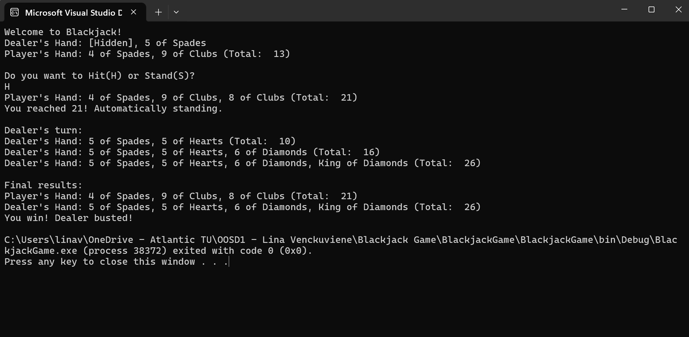
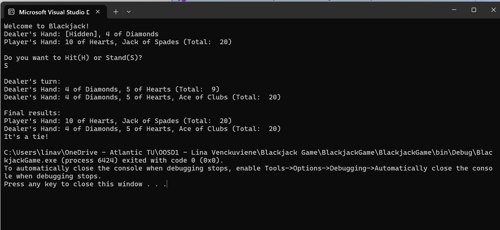
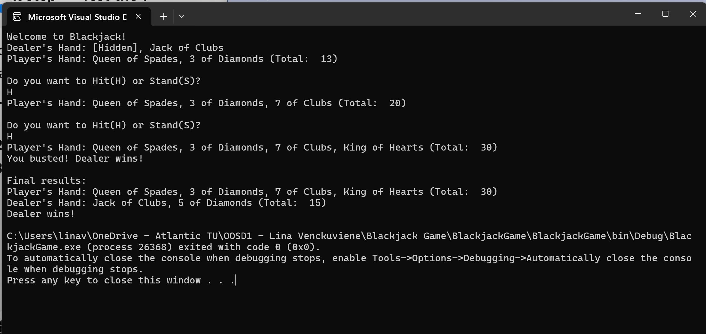
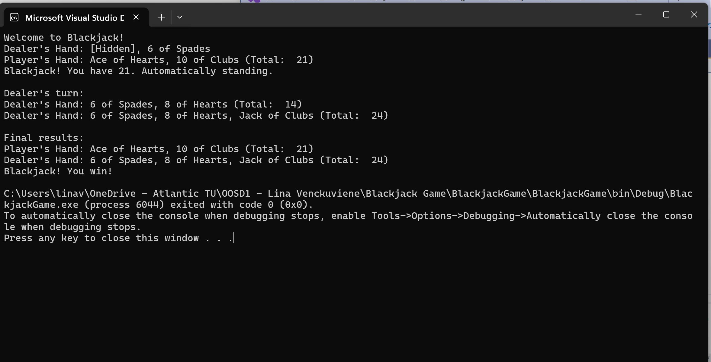

# Blackjack Game – C#

A console-based Blackjack card game developed in C# using Visual Studio 2022.

This project demonstrates object-oriented programming (OOP), game logic, user input validation, and the use of classes and collections in C#.

## Project Overview

The application allows a player to play Blackjack against a computer-controlled dealer.

The objective is to achieve a hand value as close to 21 as possible without exceeding it.

The game follows basic Blackjack rules, including card dealing, Hit or Stand decisions, dealer behaviour, and winner determination.

## Technologies Used

- C#
- .NET
- Visual Studio 2022
- Object-Oriented Programming (OOP)
- Console Application

## Features
- Automatically stands when the player's hand reaches 21.
- Recognises a natural Blackjack (an Ace and a 10-value card dealt initially).
- Distinguishes a natural Blackjack from an ordinary 21 when determining the winner.

### Card Deck
- Creates a deck of playing cards.
- Shuffles the deck before the game starts.
- Deals cards to the player and dealer.

### Player Gameplay
- Each participant receives two initial cards.
- The player can choose to Hit or Stand.
- Hit draws another card.
- Stand ends the player's turn.
- Invalid input is handled with an error message.

### Dealer Gameplay
- The dealer plays automatically.
- The dealer draws cards while the hand value is below 17.
- The dealer stops drawing when the hand reaches 17 or higher.

### Blackjack Rules
- Hand values are calculated automatically.
- Aces can count as 1 or 11.
- Bust detection occurs when a hand exceeds 21.
- The game determines whether the player wins, the dealer wins, or the result is a tie.

## Project Structure

| File | Description |
|------|-------------|
| Program.cs | Application entry point |
| Blackjack.cs | Main game logic and game flow |
| Card.cs | Playing card representation |
| Deck.cs | Card deck management |
| Player.cs | Player and dealer hand management |
| BlackjackGame.csproj | C# project configuration |
| BlackjackGame.sln | Visual Studio solution |

## How to Run

1. Download or clone this repository.
2. Open `BlackjackGame.sln` in Visual Studio 2022.
3. Build the solution using `Ctrl + Shift + B`.
4. Press `Ctrl + F5` to run the application without debugging.
5. Follow the instructions displayed in the console to play Blackjack.

## Programming Concepts Demonstrated

- Object-Oriented Programming
- Classes and Objects
- Constructors
- Methods
- Encapsulation
- Lists and Collections
- Loops and Conditional Statements
- User Input Validation
- Game Logic Implementation

## Learning Outcomes

This project helped develop practical skills in C# programming, including designing classes, managing program flow, implementing game rules, and organising code into reusable components.

## Game Screenshots

The screenshots below demonstrate different outcomes of the Blackjack game.

### 1. Player Wins

### 2. Tie Game

### 3. Player Busted

### 4. Natural Blackjack

## Author

Lina Venckus (Venckuviene)

Computer Science Graduate

Atlantic Technological University (ATU)
